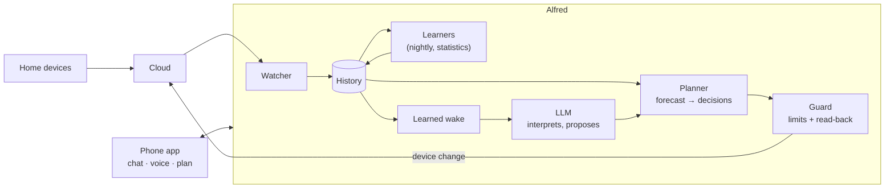

# Alfred: architecture

> **In short.** Alfred sits on top of the smart-home cloud the devices already report to. It watches every device, learns the home's rhythms with plain statistics, and gets the house ready before people need it. The LLM only interprets and proposes. Code decides, and code guards every change to a device.

## What the people at home get
| Moment | Without Alfred | With Alfred |
|---|---|---|
| **Coming home** | Heating goes on when you walk in; cold for ~25 min | Alfred knows "Ana gets home weekdays around 18:38" and how fast the house warms. **21.2 °C when she walks in**, instead of 18.3 °C |
| **Waking up** | Same, every morning | Warm at the learned time, with different weekday and weekend windows |
| **A party** | Routines fire as usual | Alfred recognises the evening from past ones (guests' phones, the door), lowers the heating and moves tomorrow's warm-up later |
| **Staying in control** | Rules to write and maintain | The phone app says what Alfred did and why. Skip, undo, or just ask, by text or voice, in Portuguese or English |

**Why people can trust it:**
- Every confidence is computed from counts.
- Alfred acts only at 0.75 or more and suggests below that.
- Every change is checked against limits and read back from the device.
- A person's change always wins.

## How it fits together

| How often | Who | What |
|---|---|---|
| Every 20 s | Code | Read the home, note what changed, run what is due |
| Every 5 min | Code | Re-plan the next 24 h from the forecast |
| On a learned event | LLM | "Ana is due in 45 min, the house is at 18.5 °C": propose what to do and why |
| Every night | Code | Re-learn all habits and occasions from the whole history |

**The LLM never runs on every reading.** It is woken by what Alfred learned. A habit about to start, an arrival, a missing routine, a party. That keeps it cheap, consistent and explainable.

## Five words
- **Pattern:** one thing that recurs at a consistent time ("door, then kettle, around 08:05").
- **Habit:** patterns that recur together with a rhythm ("Waking up: weekdays 07:08, weekends 08:53").
- **Occasion:** a rare evening recognised by resemblance to past ones ("Friday night gathering").
- **Decision:** something Alfred **does** (confidence ≥ 0.75) or only **suggests**.
- **Guard:** the code that allows, limits and verifies every device change.

**Built with:** Python and SQLite; scikit-learn and SciPy for the statistics; LangGraph with any model through OpenRouter; speech to text on the home's own computer (Parakeet); a React phone app.
