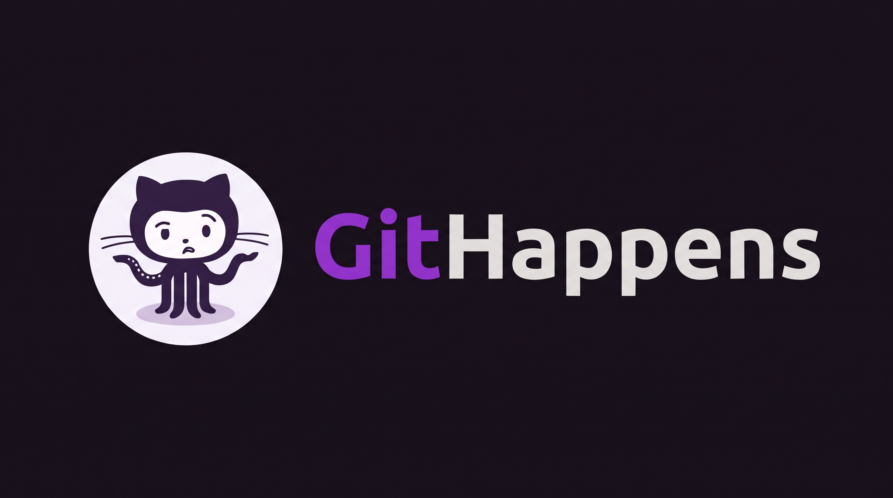

# Alfred · team GitHappens



**A home that builds its own sensors:** Alfred learns what the devices' signals mean from the home's own history, and shows that as new sensors you can see, ask about and talk to.
Aveiro Tech City Hackathon 2026, Altice Labs Desafio #3 ("Connected Home, Reimagined").

## Docs
| Doc | What it's for | Read when |
|---|---|---|
| [`docs/starting-plan.md`](docs/starting-plan.md) | **The starting plan:** how Alfred learns its own sensors, the parts to build, the shapes to agree, who builds what | First |
| [`docs/learned-sensors-plan.md`](docs/learned-sensors-plan.md) | Earlier build plan (sensors as SQL queries), superseded by the starting plan | For background only |
| [`docs/synapse.md`](docs/synapse.md) | Earlier concept under the old name (rules, verification, memories); not yet rewritten around Alfred | For background only |
| [`docs/simulator.md`](docs/simulator.md) | **The simulator:** how to generate a household's history, the presets, the real house | Before generating data |
| [`docs/learners.md`](docs/learners.md) | **The learners:** how the grouper and habit learner find sensors, and how to run them | Before touching `source/learn/` |
| [`docs/event-loop.md`](docs/event-loop.md) | **The event loop:** polling, triggers, heartbeat, when the LLM wakes, how the learners plug in | Before writing the poller or agent |
| [`docs/mcp-capabilities.md`](docs/mcp-capabilities.md) | What the Altice MCP can see, change and can't do; device IDs | Before writing code |
| [`docs/altice-hackathon-brief.md`](docs/altice-hackathon-brief.md) | Challenge, schedule, judging criteria, rules | Before the pitch or report |
| [`deliverables/README.md`](deliverables/README.md) | What we hand in, limits and deadlines | Before each deadline |
| [`deliverables/templates/`](deliverables/templates/) | Organiser templates: slide deck (`.pptx`), executive summary links | When starting a deliverable |
| [`docs/reference/hardware-list.md`](docs/reference/hardware-list.md) | Kit hardware: models, radios, how each device reaches the MCP, **safety rules** | Before touching the physical kit |
| [`docs/reference/`](docs/reference/) | Organiser PDFs and strategy research | When you need the source |
**Build from these**
| Doc | What it's for |
|---|---|
| [`docs/starting-plan.md`](docs/starting-plan.md) | **Read first.** How Alfred learns its own sensors, the parts to build, the shapes to agree, who builds what |
| [`docs/event-loop.md`](docs/event-loop.md) | The built loop: polling, triggers, the agent, ingest and the learners, how to run and test it |
| [`docs/simulator.md`](docs/simulator.md) | The simulator: how to generate a household's history, the presets, the real house |
| [`docs/mcp-capabilities.md`](docs/mcp-capabilities.md) | What the Altice MCP can see, change and can't do; how to connect |
| [`docs/reference/hardware-list.md`](docs/reference/hardware-list.md) | The physical kit and its **safety rules** |

**Hackathon**
| Doc | What it's for |
|---|---|
| [`docs/altice-hackathon-brief.md`](docs/altice-hackathon-brief.md) | Challenge, schedule, judging criteria, rules |
| [`deliverables/README.md`](deliverables/README.md) | What we hand in, limits and deadlines; organiser templates in [`deliverables/templates/`](deliverables/templates/) |

**Background (don't build from these)**
| Doc | What it is |
|---|---|
| [`docs/synapse.md`](docs/synapse.md) | The earlier concept (old name SYNAPSE): the Rosa story, rules, verification, memories, business case |
| [`docs/learned-sensors-plan.md`](docs/learned-sensors-plan.md) | The earlier build plan (sensors as SQL queries), superseded by the starting plan |
| [`docs/reference/`](docs/reference/) | Organiser PDFs and strategy research |

## Project drive
[Shared team folder](https://drive.google.com/drive/folders/1SPYUYUx7WPJ9xSI5GlHnbtpvS0-Cky2o?usp=sharing) on Google Drive, with templates and working files for the deliverables.

## Key dates
- **Wed 18 Nov, afternoon:** mentor checkpoint (online, mandatory)
- **Wed 18 Nov, 19:00:** approach report due (max 2 pages)
- **Fri 20 Nov, 17:30:** executive summary (PDF, max 2 pages) + slides + repo link
- **Fri 20 Nov, 18:00:** pitches (3 min + 1 min Q&A; finalists 5 min + 3 min Q&A)

## Setup: connect to the Altice MCP
1. `cp .mcp.example.json .mcp.json`, then put in the team API key and the absolute path to `tools/connected_home_auth.py`.
2. `python3 tools/connected_home_auth.py login` (one-time browser sign-in with the team account).
3. Start Claude Code in this folder and check `/mcp` shows `connected-home` connected.

## Run
```
cp .env.example .env     # add the team API key as CGH_API_KEY, and OPENROUTER_API_KEY for the LLM agent
uv run python -m source --replay tests/fixtures/morning.jsonl   # demo morning, no kit needed
uv run python -m source                                         # live loop
uv run python -m source.ask "make the lamp blue"               # ask the agent once, on the live house
node console/server.mjs                                         # console: live devices at http://localhost:4780
uv run python -m source.simulate --days 14 --household rosa --out data/sim/rosa.jsonl   # simulated history
uv run python -m source.simulate --serve                        # the same, from a form in the browser
uv run python -m source.pipeline --household rosa --days 14 --out data/sim/rosa/ --replace   # simulate + ingest + learn, per day
uv run python -m source.learn.happenings data/sim/rosa/        # what it found
uv run python -m source.recording data/sim/rosa/ --out dashboard/public/recording.json --household rosa   # that run, for the dashboard
cd dashboard && npm install && npm run dev                      # jury dashboard: plays back dashboard/public/recording.json
```
All options, logs and tests: [`docs/event-loop.md`](docs/event-loop.md#running-and-testing-it). The console needs `.mcp.json` in the stdio form, not the HTTP form from step 1: see [`docs/mcp-capabilities.md`](docs/mcp-capabilities.md#connecting).

## Repo structure
```
README.md               you are here
.mcp.example.json       MCP config template (the real .mcp.json is gitignored)
docs/
  starting-plan.md      how Alfred learns, what we build first
  event-loop.md         polling loop + agent triggers, ingest, rest and happenings
  simulator.md          generating a household's history
  mcp-capabilities.md   MCP reference
  altice-hackathon-brief.md
  synapse.md, learned-sensors-plan.md   earlier concept and plan (background)
  reference/            hardware list, organiser material, research
deliverables/           report, executive summary, slides (+ organiser templates)
assets/                 logo and images
console/                live device page (debugging)
dashboard/              jury dashboard (React + Vite): plays back a recorded simulated run (dashboard/README.md)
tools/                  connected_home_auth.py (OAuth helper used by .mcp.json), extract_smart_home_a.py (builds the real-house data)
source/                 event loop: poll the MCP, diff, store, triggers, agent (LangGraph + stub), logs, show
  learn/                learners: kinds, links, habits, sensor storage (docs/learners.md)
tests/                  replay tests; fixtures = a real get_home snapshot + a demo morning
```
Built: `source/simulate.py` (the simulator, [`docs/simulator.md`](docs/simulator.md)) · `source/learn/` rest, happenings, kinds, habits, sensor storage ([`docs/learners.md`](docs/learners.md)) · `source/pipeline.py` (simulate 14 days, parts 1–6). `dashboard/` (the jury dashboard, on a mock recording). Planned ([`docs/starting-plan.md`](docs/starting-plan.md)): the namer · the dashboard on live simulated data.
  ingest.py, clock.py   JSONL snapshots → history at full speed; Lisbon days
  simulate.py           the simulator (+ simulate_web.py, sim_data/)
  learn/                rest.py, happenings.py (starting plan parts 3 and 4)
  pipeline.py           simulate + ingest + learn, one day at a time
  recording.py          a run's history as the dashboard's recording (one JSON file)
tests/                  replay and simulated-data tests; fixtures = a real get_home snapshot + a demo morning
```
Planned ([`docs/starting-plan.md`](docs/starting-plan.md)): `source/learn/` (kinds, habits, namer) · sensor storage · the dashboard in `console/`.

## Conventions
- **Never commit secrets:** `.mcp.json`, `.env` and tokens stay local (see `.gitignore`).
- Docs in English, file names in kebab-case.
- Scenarios we create on the Altice platform are named `SY · <name> · v<n>`. They can't be deleted, so create them only after the format is confirmed.
- `docs/reference/` holds source material (organiser docs, kit notes): summarise it in `docs/` rather than copying it.
- Physical kit: only a small lamp on the smart plug, warn people before testing the smoke alarm, never arm the alarm (see the hardware list).
