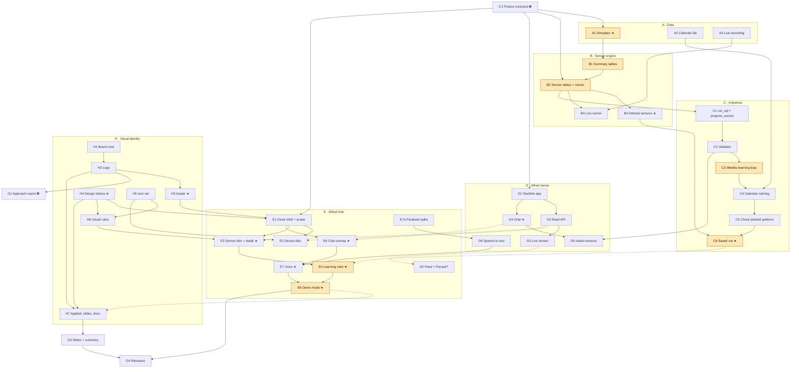

# Alfred: build tree

The whole build as one tree, so each of us can pick a branch and see what it waits on. It follows [`learned-sensors-plan.md`](learned-sensors-plan.md) (the spine), adds **asked** sensors from [`use-cases.md`](use-cases.md) V, and adds the **frontend** (the Alfred Hub, with chat and voice, built for the demo) and Alfred's **visual identity** (logo, avatar, design tokens, visual rules). Older reasoning: [`build-path.md`](build-path.md) · story: [`synapse.md`](synapse.md) · loop: [`event-loop.md`](event-loop.md).

Legend: ⛔ blocks others · ★ demo-critical · ⚪ stretch · ⬜ not started · 🟡 partly · ✅ done. Owners are suggestions: confirm them at stand-up.

## Decisions (17 Nov)
- **Name: Alfred** (replaces SYNAPSE).
- **Spine: learned sensors.** The home builds its own sensors from its history.
- **Three origins, one record:**
  - `defined`: we write it, and every home gets it.
  - `inferred`: the LLM finds a pattern in this home's history.
  - `asked`: a person describes it in chat or by voice ("Alfred, make a sensor that knows when the room is being aired"). It uses the same `run_sql`, validator and backfill as `inferred`.
- **A sensor is SQL over the three summary tables only**, run read-only with a row limit and a timeout. That SQL is the "declarative spec": no free code.
- **Kept from the old plan:** the write guard and read-back verification (level 2), already in [`source/guard.py`](../source/guard.py). The hub and the chat show "✓ confirmed".
- **Now stretch:** rules from routines (use case A), memories, calendar setup cards (use case E).
- **Hub layout: tablet kiosk** (tentative, so build it from components). **Voice: Parakeet speech-to-text** (multilingual, detects the language).
- **Alfred has its own identity**, separate from the team's: its own logo, avatar, palette and type. The hub, slides, report and summary all follow the same [visual rules](#visual-identity). The GitHappens logo appears only where we introduce the team.

## Where the plans clashed, and what we chose
| Clash | Learned-sensors plan | build-path / use-cases | Chosen |
|---|---|---|---|
| How a sensor is born | Defined or inferred from history | A person describes it | All three, one record (`origin`) |
| What a sensor is made of | An SQL query | "A declarative spec, never code" | SQL limited to the summary tables, read-only, limited |
| Scope | Sensors only | Also rules, verification, memories (⑤–⑧) | Sensors, plus the verification that already exists; the rest is stretch |
| Name and persona | No product name | SYNAPSE, Rosa and Ana | Alfred; the Rosa story is optional |
| Demo | "X months simulated, these are the sensors it learned" | 21-day replay / a sensor from a sentence | The [demo](#demo) below combines them |

## The tree
```
ALFRED: a home that builds its own sensors (submit Fri 20 Nov, 17:30)
│
├─ 0  Align (Tue 17) ⛔ everything waits on this
│   ├─ 0.1 Lock the direction: learned sensors + asked · name Alfred · one demo script
│   ├─ 0.2 Freeze the sensor record + hub API (see Contracts) ⛔ B, C, D, E
│   └─ 0.3 Planning docs in the repo · start the live recording (A3)
│
├─ A  Data
│   ├─ A1 ★ Simulator: months of get_home JSONL, devices by type, planted patterns, noise, outside temperature ⛔ B1
│   ├─ A2 Calendar file (dinners, trips) ──► C4
│   └─ A3 Live recording running (--stub), so one sensor runs on real history
│
├─ B  Sensor engine                       needs A1, 0.2
│   ├─ B1 Summary tables: episodes · intervals · daily digest (pattern-agnostic)
│   ├─ B2 sensors + sensor_readings tables, plus the runner (backfilling = updating)
│   ├─ B3 ★ Defined: Awake · Asleep · Someone home · Appliance on the plug · Insulation
│   └─ B4 Live: the runner runs every tick; virtual readings flow through diff and triggers
│
├─ C  Inference                           needs B1, B2
│   ├─ C1 Tools: run_sql (read-only, row limit, timeout) · propose_sensor
│   ├─ C2 Validator: errors, no rows, too few days, overlap → reason sent back
│   ├─ C3 Weekly learning loop with a time cutoff (no seeing the future)
│   ├─ C4 Calendar as a table → names the patterns
│   ├─ C5 Check against the planted patterns: Morning tea · Dinner with friends · Kettle getting slower
│   └─ C6 ★ Saved run, frozen (sensors + readings + the week each was learned) ⛔ demo
│
├─ D  Alfred server                       needs 0.2; serves mock data until B and C land
│   ├─ D1 Starlette app: one MCP session, the loop in-process, serves the hub
│   ├─ D2 Read API: /home · /sensors?at= · /sensors/{id}/readings · /timeline · /feed
│   ├─ D3 Live push: /stream (SSE)
│   ├─ D4 ★ Chat: /chat (SSE), a chat agent on agent.py's graph + guard + Alfred tools
│   ├─ D5 Asked sensors: chat → run_sql / propose_sensor → validator → backfill   needs C1, C2
│   ├─ D6 Speech-to-text: /voice (16 kHz WAV) → Parakeet → text
│   └─ D7 ⚪ Alfred MCP server (FastMCP) with the same tools, for the MyButler pitch
│
├─ E  Frontend: Alfred Hub                starts now, on mock JSON
│   ├─ E1 Kiosk shell: clock, live badge, theme; uses H4's tokens and H3's avatar
│   ├─ E2 Real-device tiles (7): read-only, plus lamp quick actions. No alarm buttons
│   ├─ E3 ★ Learned-sensor tiles + detail sheet (explanation, history, query, week learned, badge)
│   ├─ E4 ★ Learning view: timeline scrubber + play; tiles pop in on learned_at (7 → 12+)   needs C6
│   ├─ E5 Activity feed + "Porquê?" (why each thing happened)
│   ├─ E6 ★ Chat overlay: streamed replies, tool steps, "✓ confirmed" chips   needs D4
│   ├─ E7a Parakeet spike (1 h): CPU speed? Python 3.14 wheels? PT and EN?
│   ├─ E7 ★ Voice: Talk button → 16 kHz WAV in the browser → /voice → chat → spoken reply
│   └─ E8 ★ Demo mode: scripted beats, keyboard shortcuts, works offline (saved run + replay)
│
├─ F  Keepers
│   ├─ F1 Rename SYNAPSE → Alfred in source/prompts/agent.md and event-loop.md
│   ├─ F2 Verification level 2 (already in code) shown in the hub and the chat
│   └─ F3 ⚪ Rules from sensors (A) · memories · calendar setup cards (E)
│
├─ G  Pitch and deliverables
│   ├─ G1 ⛔ Approach report + mentor questions: Wed 18, 19:00
│   ├─ G2 Rewrite synapse.md around Alfred and learned sensors (plan step 4.3)
│   ├─ G3 Slides (pptx template) + executive summary: Fri 17:30   needs H2, H7
│   └─ G4 Rehearse on the hub; record a backup video
│
└─ H  Visual identity                      starts now; feeds E and G
    ├─ H1 Brand core: tagline, voice and tone (how Alfred talks and writes)
    ├─ H2 Logo: Alfred mark + wordmark + lockup (light, dark, mono), favicon, PNG exports ⛔ G1 header, G3
    ├─ H3 ★ Avatar: the mark as an animated SVG with 5 states (idle · listening · thinking · speaking · alert) ⛔ E1
    ├─ H4 ★ Design tokens: colour, type, spacing, radius, shadow, motion → hub/tokens.css ⛔ E1
    ├─ H5 Icon set: one per sensor category and device type; focus and origin badges
    ├─ H6 Visual rules: tile anatomy, what colour means, projector legibility, motion (see below)
    └─ H7 Applied: slides on the organisers' template, report/summary header, README banner, hub screenshots
```

### Dependencies
Solid arrow: needs it. Dashed arrow: uses mock data until it exists. Highlighted: the critical path.

**Critical path:** A1 → B1 → B2 → C3 → C6 → E4 → E8. The simulator is the bottleneck, so it starts today.

**Parallel from today, on mocks:**
- D1 → D2 → E2/E3 (server and tiles)
- D4 → E6 → E7 (chat, then voice)
- E7a (the Parakeet spike)
- H1 → H2 → H3 and H4 (the identity, needed before E1 settles)
- G1 (the report)

## Branches in detail
| Node | Done when | Owner | Status |
|---|---|---|---|
| 0.2 | The sensor record and API below are agreed by all four | All | ⬜ |
| 0.3 | This PR merged; `uv run python -m source --stub` recording on one laptop | João | 🟡 |
| A1 | Several months of JSONL replay through `ReplaySource` unchanged; patterns planted, noisy, devices found by type (not the old IDs in `tests/fixtures/make_morning.py`) | Gabriel | ⬜ |
| A2 | A calendar file with dinners and trips that line up with the planted evenings | Gabriel | ⬜ |
| B1 | Episodes, intervals and daily-digest tables built from `events`; nothing in them names a pattern | Gui | ⬜ |
| B2 | A sensor's query, run over the history, writes its readings; running it again updates them | Gui | ⬜ |
| B3 | 5 defined sensors with calibrated parameters and a `learned_at` date | Gui | ⬜ |
| B4 | A virtual reading changes during a live or replay tick and can fire a trigger | Gui | ⬜ |
| C1–C2 | The LLM explores with `run_sql` and gets a reason back for each rejected proposal | Gui | ⬜ |
| C3–C5 | The weekly loop finds Morning tea, Dinner with friends and Kettle getting slower without hints in the prompt | Gui | ⬜ |
| C6 | Saved run in the repo; the hub plays it back with no LLM | Gui | ⬜ |
| D1–D3 | `uv run python -m source.server` serves the hub and the API (mock or real), and the loop runs inside it | Gabriel | ⬜ |
| D4 | A multi-turn chat that reads sensors and devices, writes through the guard, and streams its reply | Gabriel | ⬜ |
| D5 | "Make a sensor that…" in chat produces a validated sensor with its history filled in | Gabriel | ⬜ |
| D6 | Speech becomes text on CPU in well under 2 s for a short phrase, in PT and EN | João | ⬜ |
| E1–E3 | Kiosk with the avatar, 7 device tiles and the learned-sensor tiles from mock JSON; a tile opens its detail sheet | Rui | ⬜ |
| E4 | Play goes through the months and tiles appear on their date | Rui | ⬜ |
| E5–E6 | Feed with "Porquê?"; chat overlay with streamed replies and "✓ confirmed" chips | Rui | ⬜ |
| E7 | Hold Talk, speak, and Alfred answers out loud in the language you spoke | João | ⬜ |
| E8 | The whole demo runs from shortcuts with Wi-Fi off (except the LLM) | Rui | ⬜ |
| F1–F2 | No "SYNAPSE" left in code or prompts; "confirmed" or "couldn't confirm" shown wherever a write happens | Anyone | 🟡 (F2 in code) |
| G1–G4 | Report sent Wed 19:00; slides and summary sent Fri 17:30; two full rehearsals | João + all | ⬜ |
| H1 | Tagline picked; a short voice-and-tone list the chat prompt and the slides both follow | João | ⬜ |
| H2 | `assets/alfred/`: mark, wordmark and lockup as SVG (light, dark, mono), `favicon.svg`, 1024 px PNGs for the pptx | João + Rui | ⬜ |
| H3 | One SVG whose 5 states are switched by a CSS class, so the hub animates the same drawing the slides show | Rui | ⬜ |
| H4 | `hub/tokens.css` with every colour, size, radius and motion value below, in light and dark; nothing hard-coded elsewhere | Rui | ⬜ |
| H5 | One icon per category and device type, all from one set; badges show a word, not just a colour | Rui | ⬜ |
| H6 | The rules below agreed by the team; the hub is checked against them on the real projector | All | ⬜ |
| H7 | Slides, report and summary carry the lockup and the palette inside the organisers' template; screenshots come from the hub | João | ⬜ |

## Schedule
| Day | Goals | Deadline |
|---|---|---|
| Tue 17 (pm) | 0.x · A1 started · A3 running · D1 + mock API · E1 shell · E7a spike · H1 + H4 draft | — |
| Wed 18 | A1 done · B1–B2 · first B3 sensors · D2 · E2–E3 · F1 · H2–H3 (logo on the report) · H5–H6 | **Mentor checkpoint · report 19:00 (G1)** |
| Thu 19 | C1–C5 · D4 · D5 · D6 · E4–E7 · H7 slides started | — |
| Fri 20, 09:30–16:30 | C6 frozen by ~12:00 · E8 · H7 screenshots · G3 · rehearse | **Submit 17:30 · pitch 18:00** |

**If we fall behind, cut in this order:**
1. D7 (MCP server)
2. D5 (asked sensors)
3. Insulation
4. Spoken replies (keep text)
5. Parakeet (fall back to the browser's speech recognition, then to typing)
6. A custom icon set (H5): use emoji instead

**Never cut:** B3, C6, E3, E4, E6, and the basics of the identity (H2 logo, H3 avatar, H4 tokens), since presentation is scored.

## Contracts (freeze at 0.2)

**Sensor record:** the plan's 1.2 fields, plus *proposed* fields for the hub:
```
name          "Morning tea"
focus         connected_life | connectivity | <third, open>
category      people | events | appliances | measurements
origin        defined | inferred | asked                 ← asked is new
query         SQL over the summary tables, returning (ts, ts_end, value)
explanation   one sentence in plain words
confidence    0–1
learned_at    the date it first had enough evidence
── proposed ──
id            stable slug, e.g. "morning-tea"
kind          state | event | measure                    how the hub draws it
icon          one emoji for the kiosk tile
unit          for measures ("W", "°C/h", "%")
proposed_week inferred only: the week the LLM proposed it
sentence      asked only: what the person said
```
**Reading:** `(sensor_id, ts, ts_end, value)`.

**Hub API.** Run it with `uv run python -m source.server`. `ALFRED_MOCK=1` serves `hub/mock/*.json` instead.

| Endpoint | Returns |
|---|---|
| `GET /api/home` | `{now, mode: live\|replay\|saved, devices: [{id, name, type, fresh, lastSeen, values}]}` |
| `GET /api/sensors?at=<ms>` | Sensors with `learned_at ≤ at`, each with `value_now` and `since` |
| `GET /api/sensors/{id}/readings?from=&to=` | Readings |
| `GET /api/timeline` | `{start, end, weeks: [{cutoff, proposed[], refined[], retired[]}]}` |
| `GET /api/feed?since=` · `GET /api/stream` (SSE) | `{ts, kind: event\|rule\|agent\|sensor_learned, text, why}` |
| `POST /api/chat {session, text}` → SSE | Tokens, tool steps, then `{text, lang, actions[], sensors_created[]}` |
| `POST /api/voice` (WAV, 16 kHz mono) | `{text, ms}` |

**What to reuse:**
- **The chat agent** (`source/chat.py`) builds on `make_model`, `build_graph`, `guard_writes` and `mcp_tools` in [`source/agent.py`](../source/agent.py) and on `build_context` in [`source/context.py`](../source/context.py).
  - `build_graph` gets a `report=False` option, so chat returns plain text instead of the JSON report.
  - `allow_plug_on=True`, because a person asked, as in [`source/ask.py`](../source/ask.py).
- **Alfred's own tools** (`source/alfred_tools.py`: `list_sensors`, `sensor_readings`, `what_happened`, `explain_sensor`, `run_sql`, `propose_sensor`) are written once. C1, the chat agent and the D7 MCP server all use them.
- **One MCP session:** the loop and the chat share `McpSource.session()`, as [`source/__main__.py`](../source/__main__.py) already does.
- **No new web packages:** `starlette`, `uvicorn`, `sse-starlette` and `mcp.server.fastmcp` already come with `mcp` in `uv.lock`. Declare them in `pyproject.toml` anyway.

## Frontend: Alfred Hub
A wall-tablet kiosk on the projector. Alfred is the face of the home: a small, friendly butler avatar whose states are **idle · listening · thinking · speaking · alert**.

**Stack:**
- Vanilla JS (ES modules, no build step), like [`console/`](../console/), in `hub/`, served by the Alfred server.
- No CDN at the venue: fonts and icons are local, or emoji.
- Components rather than one page, so the layout can still change.

| Screen | What it shows |
|---|---|
| **Home** | Clock, avatar, one plain-words status line ("Someone's home. Tea was at 08:21."), big learned-sensor tiles grouped by focus, a strip for the 7 real devices, the Talk button |
| **Tile detail** | Explanation, history sparkline, confidence, the defined / inferred / asked badge, **the SQL and the week it was learned** (the answer to "are these hard-coded?") |
| **Learning view** | Timeline scrubber + ▶ play: the months run, Alfred proposes, tiles pop in on `learned_at` (7 → 12+) |
| **Chat overlay** | Streamed replies, tool steps as chips, "✓ confirmed" or "couldn't confirm" straight from the guard |
| **Feed** | Events, rules and agent notes; each expands into "Porquê?" |

**Voice:**
1. Hold Talk.
2. The browser records with `getUserMedia` and resamples to 16 kHz mono WAV with Web Audio, so the server needs no ffmpeg.
3. `POST /api/voice`: **Parakeet TDT 0.6B v3** on CPU through ONNX. It covers European languages, PT and EN included, and detects which one is spoken.
4. The text goes to `/api/chat`. The LLM replies in the language that was spoken and returns `lang`.
5. The browser's `speechSynthesis` speaks the reply in a voice for that `lang`.
6. The avatar follows each step.
- **Fallbacks:** the browser's speech recognition, then typing.
- **Install:** Parakeet goes in an optional `voice` dependency group, so the core still installs if the spike fails (Python 3.14 wheels).

**Look:** everything visual comes from [Visual identity](#visual-identity) (tokens in `hub/tokens.css`, the avatar from H3).

**Safety in the UI:** no arm, disarm or scenario buttons in the hub. The plug only turns on through chat, through the guard. The raw tool console stays in `console/` for development. Its arm buttons shouldn't be used on the kit ([`hardware-list.md`](reference/hardware-list.md)).

## Visual identity
Alfred is the product, so it has its own look, separate from the team's. These are starting values for H1–H6: change them in one place (this section and `hub/tokens.css`), never per screen.

### Brand core (H1)
- **Who Alfred is:** the home's butler. It's warm, calm and a little playful, it explains itself, and it never alarms without a reason.
- **Tagline (pick one):** "Your home, understood." · "The home that learns what it means." · "Sensors your home builds itself."
- **How Alfred talks**, the same in the chat, the hub and the slides:
  - Plain words and the names of things, never device IDs or raw values without a meaning: "the kettle is on", not "Plug 2140 W".
  - Short: on screen, at most two sentences, then "Porquê?" for more.
  - Honest about what's certain: "I tried but couldn't confirm" when the guard says unconfirmed; it says how confident a sensor is.
  - First person, polite, never servile and never cute about safety.
  - Replies in the language the person spoke (PT or EN).

### Logo (H2)
- **Mark:** Alfred's face is a rounded **house** with two dot eyes and a small smile, wearing a **bow tie**. The house says home, the bow tie says butler.
- **It must stay readable at 16 px:** the favicon can be the bow tie alone.
- **Wordmark:** `alfred` in lower case, in the brand typeface, extra-bold.
- **Lockup:** mark left, wordmark right.
- **Files** in `assets/alfred/`:

| File | Use |
|---|---|
| `alfred-mark.svg` | Avatar, app icon |
| `alfred-wordmark.svg` | Text-only places |
| `alfred-lockup.svg` / `alfred-lockup-dark.svg` | Slides, report header, README |
| `alfred-mono.svg` | One colour, for print or busy backgrounds |
| `favicon.svg` | Browser tab |
| `png/*@1024.png` | The pptx template, which doesn't take SVG |
- **Clear space** around the logo = the height of the bow tie. Don't stretch, rotate, recolour or add effects.
- Drawn as simple shapes **by us**, so it's original and the hub can animate it.

### Avatar (H3)
It is the same drawing as the mark, not a second character. One SVG; a CSS class sets the state:

| State | When | What moves |
|---|---|---|
| idle | Nothing happening | Slow breathing (scale 1 → 1.02, 4 s), blinks every few seconds |
| listening | Talk is held | Eyes wide, bow-tie-coral ring pulses with the voice level |
| thinking | Waiting for the chat | Eyes look up and to the side, three dots |
| speaking | Reply being read out | Mouth opens and closes with the speech |
| alert | Something needs attention | Warm amber ring, slight tilt (never red unless it's safety) |

### Design tokens (H4)
| Token | Light | Dark | Means |
|---|---|---|---|
| `--bg` | `#FFF8EE` cream | `#141B2D` midnight | Page |
| `--surface` | `#FFFFFF` | `#1F2A44` | Tiles, sheets |
| `--ink` | `#1F2A44` tailcoat navy | `#F4EFE6` | Text |
| `--muted` | `#5B6270` | `#A3ABBD` | Secondary text, raw values |
| `--brand` | `#E85D4A` bow-tie coral | `#FF7A66` | Alfred himself, as shapes: logo, avatar, rings |
| `--brand-strong` | `#C8432F` | `#FF7A66` | Coral text and coral buttons with white text (Talk) |
| `--life` | `#F2B33D` honey | `#F7C35F` | Focus: Connected Life (people, events). Navy text on it |
| `--tech` | `#2A9D8F` teal | `#3CC2B2` | Focus: Connectivity (appliances, measurements), as shapes |
| `--tech-strong` | `#1F7A70` | `#3CC2B2` | Teal text |
| `--ok` · `--warn` · `--bad` | `#23794F` · `#9A5B00` · `#B83232` | `#4CC79A` · `#F5A524` · `#FF7A59` | Status pills only |

Bright colours are for shapes, which need 3:1 contrast. `-strong` shades are for text, which needs 4.5:1. Measured on cream: navy text 13.5:1; `-strong` and status text 4.6–5.8:1; white on `--brand-strong` 4.9:1; navy on honey 7.7:1.

| Also | Value |
|---|---|
| Type | **Nunito** (rounded, open licence) at 400 / 700 / 800, served from local files, with tabular numbers for values |
| Sizes (projector) | Body ≥ 18 px · tile name 22 px · tile value 44–56 px · status line 28 px |
| Shape | Tiles 20 px radius, pills fully round, soft shadow (`0 6px 24px rgb(31 42 68 / .10)`) |
| Spacing | 8 px grid; tiles have 24 px padding and 16 px gaps |
| Motion | 200–300 ms ease-out; a new tile pops in (scale .92 → 1 with a short honey glow); `prefers-reduced-motion` turns movement off |

If the palette changes, measure contrast again, and check the hub on the real projector on Friday morning.

### Icons and badges (H5)
- **One icon per category and device type, from a single set** (or emoji, if we cut H5).
  - Sensor categories: people 🧍 · events 🍽 · appliances 🔌 · measurements 📈
  - Real devices: 💡 lamp · 🔌 plug · 🚪 door · 🌡 climate · 🔥 smoke · 📷 camera · 🛡 hub
- **Origin badge:**
  - *defined*: navy outline, "defined"
  - *inferred*: filled `--brand-strong`, white text, "learned by Alfred"
  - *asked*: filled navy with a speech bubble, "you asked"
- **Focus:** a 6 px coloured edge on the tile, honey or teal, plus the focus name in the tile's detail sheet.

### Visual rules (H6)
1. **Meaning first.** A tile's headline is a meaning ("Asleep since 23:12"). The raw value is small and muted beneath it.
2. **One tile anatomy, everywhere:** icon · name · value · since · origin badge · focus edge. The same in the hub, the slides and the report.
3. **Real and learned look different.** Real devices are flat, outlined and smaller. Learned sensors are filled, larger, and glow honey when new. "7 → 12" should read at a glance.
4. **Colour always means something:**
   - coral = Alfred
   - honey and teal = the two focus areas
   - green, amber, red = status
   - Nothing is coloured for decoration.
5. **Never colour alone.** Every badge and status has a word or an icon too.
6. **One character.** Alfred's avatar is the only mascot, in the hub, the slides and the report header. The GitHappens logo only appears where we introduce the team.
7. **Readable from the back of the room.** Use the sizes above, contrast ≥ 4.5:1, and light theme on the projector (dark is for the "night" view).
8. **Motion has a job:** showing learning (tiles appearing), listening and speaking (the avatar), and live changes (one soft pulse). Nothing loops for decoration.
9. **Real screenshots only.** Slide images come from the hub itself, never from mock-ups.
10. **Inside the organisers' template.** Their pptx sets the frame; Alfred's colours, type and lockup go inside it, not over it.

## Demo
**3 minutes (every team):**
| Time | Beat |
|---|---|
| 0:00–0:20 | **The gap:** 7 raw tiles ("Plug 2140 W", "Contact: alarm") |
| 0:20–1:10 | **"3 months of this home, simulated."** ▶ play: tiles pop in, defined and inferred badges |
| 1:10–1:50 | **Two in detail:** Dinner with friends (named from the calendar) · Kettle getting slower (its query, the week it was learned) |
| 1:50–2:35 | **Talk to Alfred:** "Is anyone home?" → an answer from the sensors · "Make the lamp warm" → the real lamp changes, ✓ confirmed |
| 2:35–3:00 | **Why Altice:** software sensors as a catalogue, every home learns itself, MyButler reads them through MCP |

**5-minute final:** adds "Alfred, make a sensor that knows when the room is being aired" (an asked sensor, its history filled in at once), plus the architecture. On stage, say **"simulated data, real learning"**.

## Open decisions
- The third focus area (only Connected Life and Connectivity are defined)
- How many months to simulate (three is enough for the kettle drift)
- Text-to-speech: the browser (default) or Piper (has pt-PT voices)
- The final hub layout (kiosk for now)
- Whether Rosa stays as the story
- The scenario name prefix (`SY ·`)
- Alfred's tagline, final palette and typeface (the starting values are under [Visual identity](#visual-identity))
